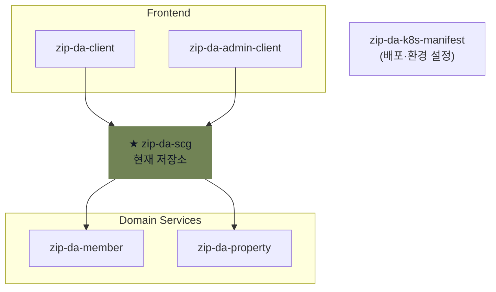

# ZIPDA API Gateway

> **ZIPDA**는 사용자와 중개사를 연결하고 회원 관리, 중개사 인증, 매물 탐색·관리 기능을 제공하는 **MSA(Microservices Architecture)** 기반 부동산 서비스이다.

`zip-da-scg`는 Spring Cloud Gateway(SCG)로 구현한 서비스로, ZIPDA MSA의 외부 요청 진입점인 API Gateway 역할을 담당한다. 인증·요청 추적·서비스 라우팅과 통합 API 문서를 공통으로 처리한다.

## ZIPDA MSA 구성



## 주요 역할

- Member·Property 서비스 요청 라우팅
- JWT 서명·만료 검증과 사용자·관리자 역할 전달
- CORS와 요청 크기 제한
- SCG 공통 오류 응답
- 서비스별 OpenAPI JSON 집계와 통합 Swagger UI 제공
- `X-Trace-Id` 생성·전파

## SCG 요청 처리 흐름

```text
Client
  → TraceIdFilter
  → AuthFilter
  → Spring Cloud Gateway Route
      ├─ Member 서비스
      └─ Property 서비스
```

SCG 서비스는 Trace ID를 적용하고, JWT가 있으면 검증하여 `X-User-Id`, `X-User-Type`, `X-User-Role` 인증 정보를 생성한 뒤 요청을 하위 서비스로 전달한다. JWT가 없는 요청은 인증 정보를 생성하지 않고 전달하며, 최종 접근 권한은 각 하위 서비스가 판단한다.

회원·권한 정책은 Member 서비스가, 매물 업무는 Property 서비스가 담당한다.

## 기술 스택

| 영역 | 기술 |
| --- | --- |
| 실행 환경 | Java 21 |
| 프레임워크 | Spring Boot 4.1.0, Spring Cloud Gateway 2025.1.2 |
| 비동기 처리 | Spring WebFlux, Reactor |
| 인증 | JJWT 0.12.6 |
| API 문서 | springdoc-openapi 3.0.3 |
| 빌드 | Gradle Wrapper 9.5.1 |

## 통합 API 문서

SCG 실행 후 다음 경로에서 Member와 Property API 문서를 확인할 수 있다.

- 로컬: `http://localhost:${APP_PORT}/docs`
- 운영: [통합 Swagger UI](https://zipda-be.meerkat.p-e.kr/docs)

## 상세 문서

| 문서 | 내용 |
| --- | --- |
| [SCG 서비스 개요](zip-da-scg-doc/01-service-overview.md) | API Gateway 역할과 서비스 책임 범위 |
| [ZIPDA API Gateway 아키텍처](zip-da-scg-doc/02-msa-gateway-architecture.md) | 공통 요청 정책, 서비스 라우팅과 추적·인증 정보 전달 |
| [JWT 인증과 Gateway 신뢰 경계](zip-da-scg-doc/03-authentication-security.md) | JWT 검증, 내부 사용자 정보 변환과 신뢰 경계 |
| [개발 환경 세팅](zip-da-scg-doc/04-development-setup.md) | 환경 변수, 실행·빌드와 서비스 연동 확인 |
